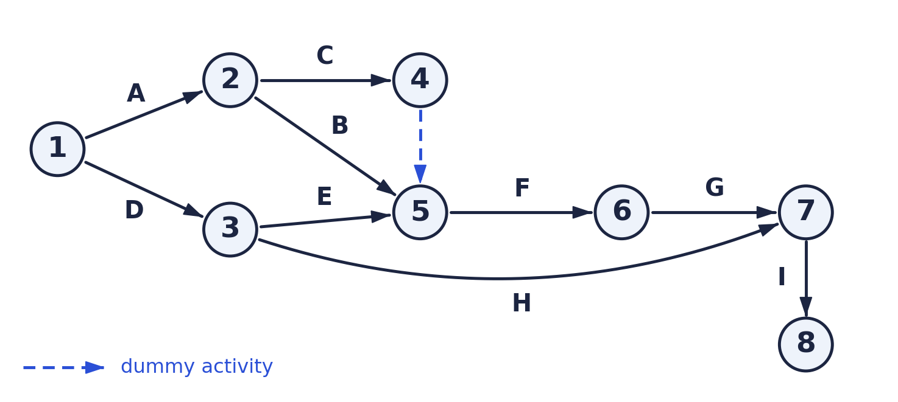
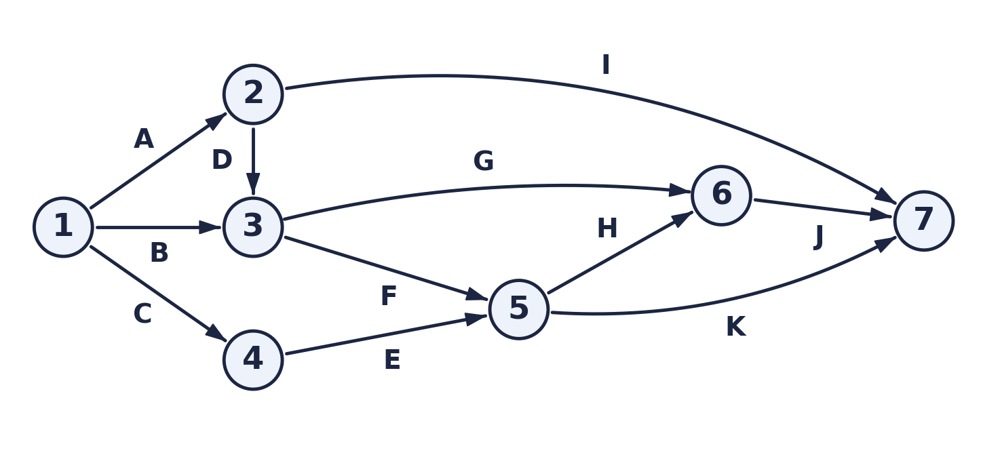
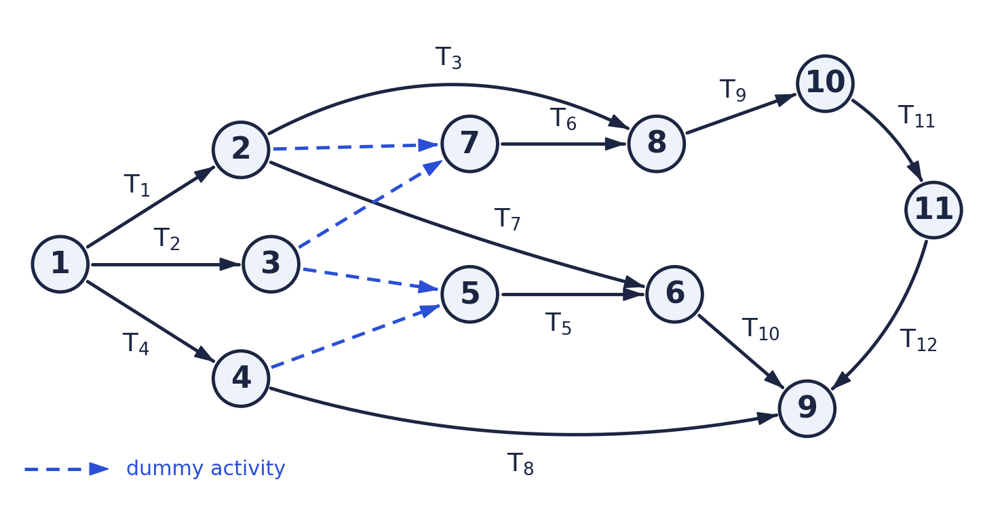
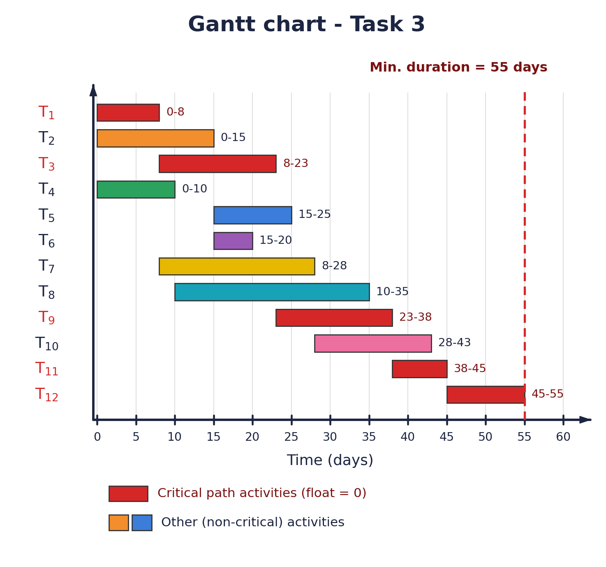

# Task 1

Draw the Pert chart for the following activities:

| Activity | Predecessor |
|:--:|:--:|
| A | - |
| B | A |
| C | A |
| D | - |
| E | D |
| F | B, C, E |
| G | F |
| H | D |
| I | G, H |

### Answer

---

# Task 2

Draw the Pert chart for the following activities:

| Activity | Predecessor |
|:--:|:--:|
| A | - |
| B | - |
| C | - |
| D | A |
| E | C |
| F | B, D |
| G | B, D |
| H | E, F |
| I | A |
| J | G, H |
| K | E, F |

### Answer

---

# Task 3

For the following activities, draw the Pert and Gantt chart, then determine the minimum project duration and the critical path:

| Activity | Duration (Days) | Predecessor |
|:--:|:--:|:--:|
| T1 | 8 | - |
| T2 | 15 | - |
| T3 | 15 | T1 |
| T4 | 10 | - |
| T5 | 10 | T2, T4 |
| T6 | 5 | T1, T2 |
| T7 | 20 | T1 |
| T8 | 25 | T4 |
| T9 | 15 | T3, T6 |
| T10 | 15 | T5, T7 |
| T11 | 7 | T9 |
| T12 | 10 | T11 |

### Answer: Pert chart

### Minimum project duration & critical path

**Minimum project duration = 55 days**

**Critical path: T1 → T3 → T9 → T11 → T12**

8 + 15 + 15 + 7 + 10 = 55 days. These activities have zero float (ES = LS), so any delay in one of them delays the whole project. The other activities have float (T2 = 3, T4 = 20, T5 = 15, T6 = 3, T7 = 12, T8 = 20, T10 = 12 days) and can be delayed by that amount without affecting the finish date.

### Answer: Gantt chart

