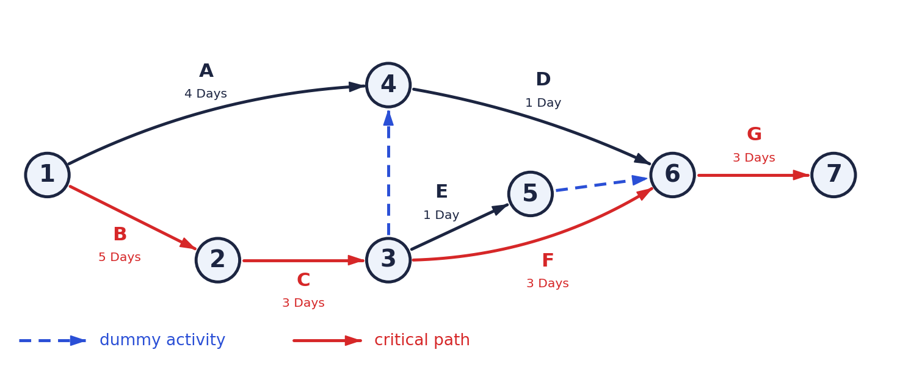
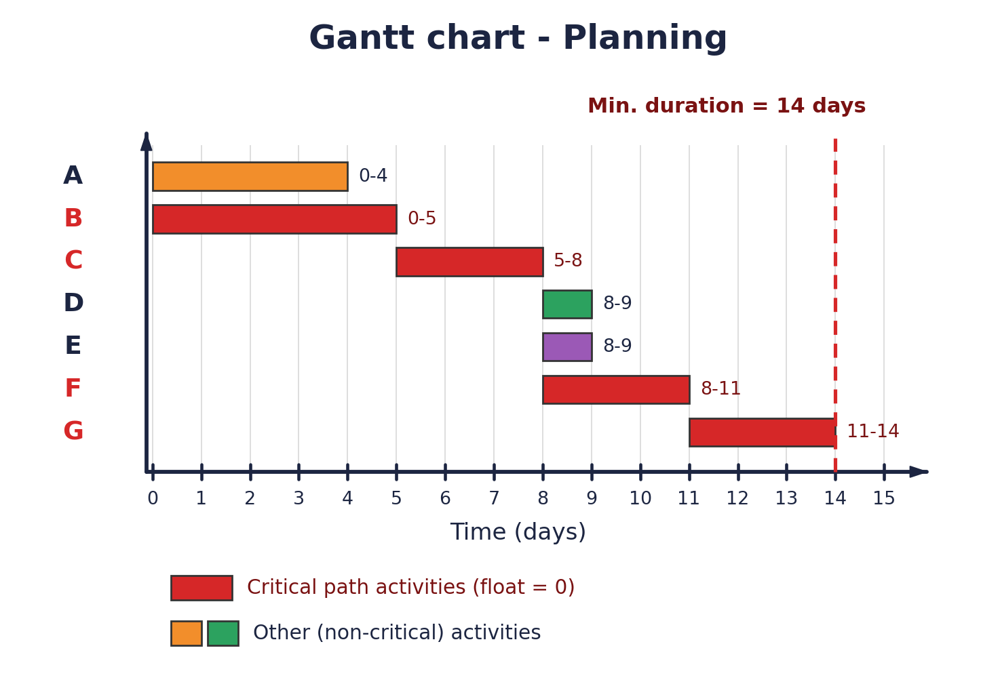

# Pert and Gantt charts

| Activity | Description | Predecessors | Duration |
|:--:|:--:|:--:|:--:|
| A | System Request | - | 4 Days |
| B | Feasibility Study | - | 5 Days |
| C | Methodology | B | 3 Days |
| D | Time Estimation | A, C | 1 Day |
| E | Task Identification | C | 1 Day |
| F | PERT Chart | C | 3 Days |
| G | Gantt Chart | D, E, F | 3 Days |

## PERT Diagram

## Gantt Chart

**Minimum project duration = 14 days**

**Critical path: B → C → F → G**

**The three tasks : [md](../solution-of-the-three-tasks/3task-pert-and-gantt-charts.md) | [Word](../solution-of-the-three-tasks/3task-pert-and-gantt-charts.docx)  |  [PDF](../solution-of-the-three-tasks/3task-pert-and-gantt-charts.pdf)**